# Updates 23.09.2026
---

# Last Status

Synthetic data working, so no optimizing error.

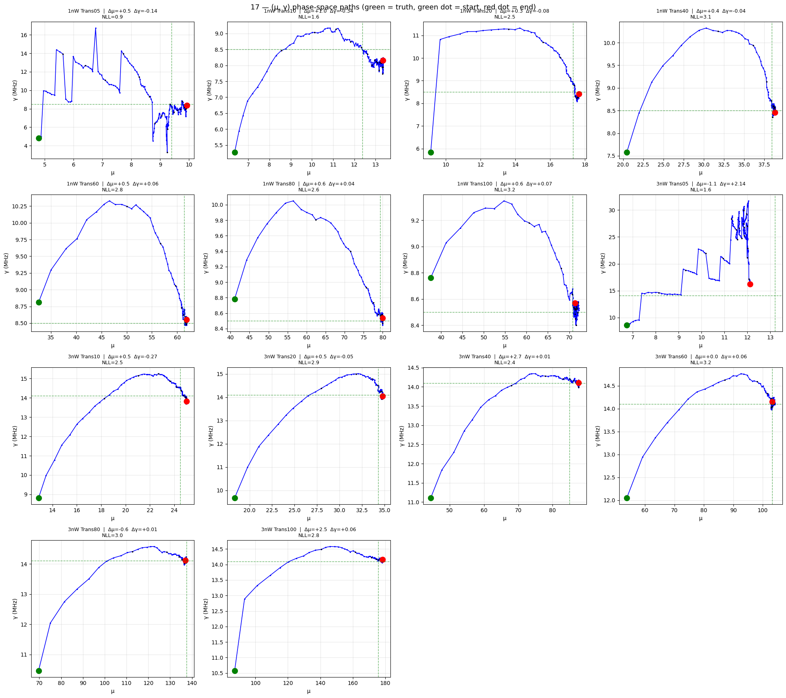

Real Data not Working

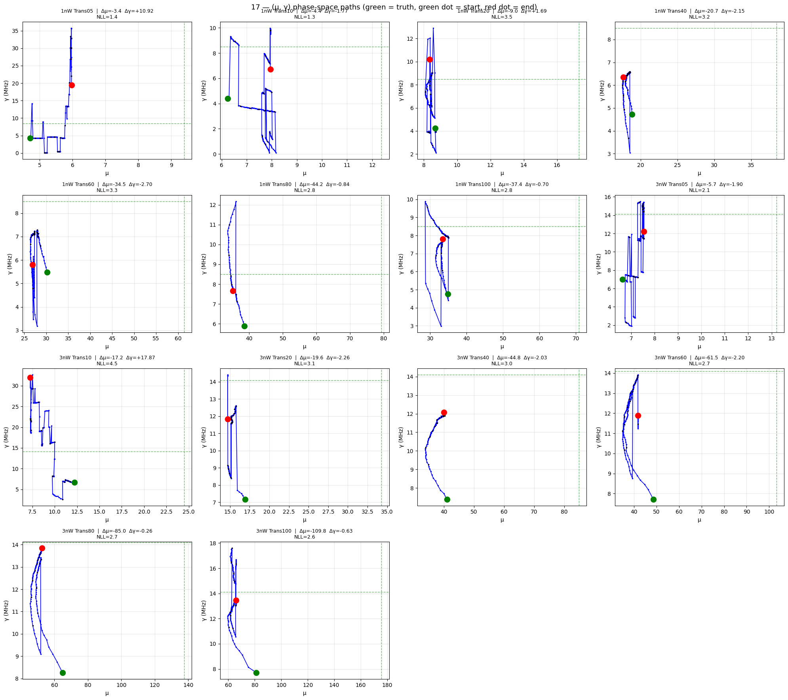

# Did first AG-HypOpt round

Playing solely with Learning and Annealing Rates

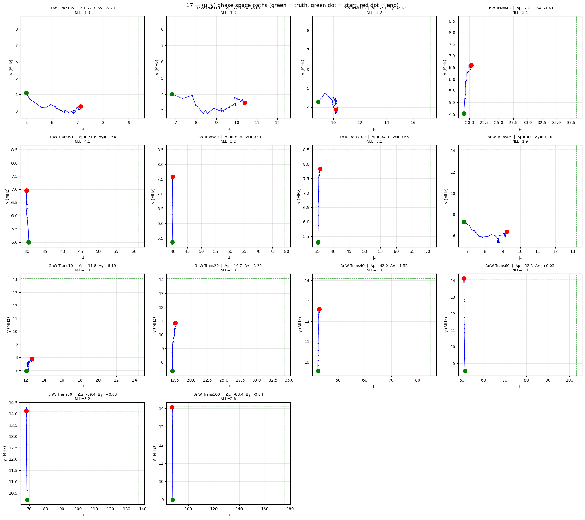

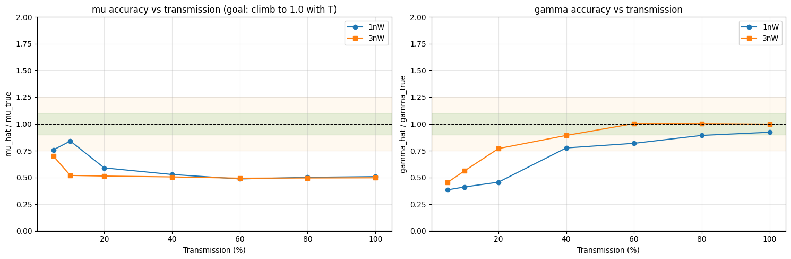
Gamma was fixed and got very close to the real results. Mu still a problem not related to LR so deeper look in the model was needed.

# $\mu$ Improvement

## Freeze correction

Several attempt to correct mu optimization:
- Different Learning Rates
- Using lm fit

**Breakthough:**
The reward per run was strongly minimized by the hyperparameter sigma_ref. Removed it.

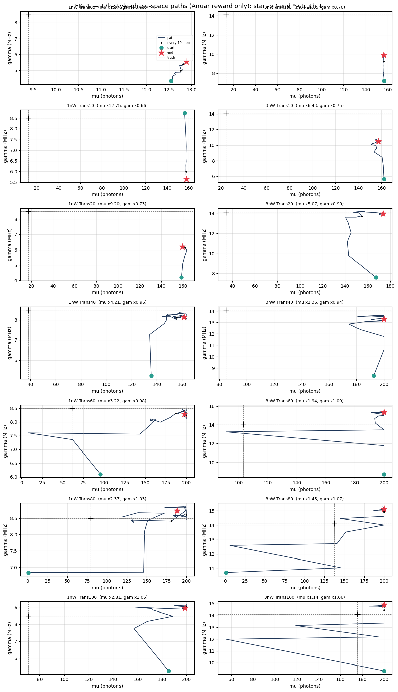

Finally movement in $\mu$

## Mu gradient correction

Several Experiments
### No mean loglikelihood but sum
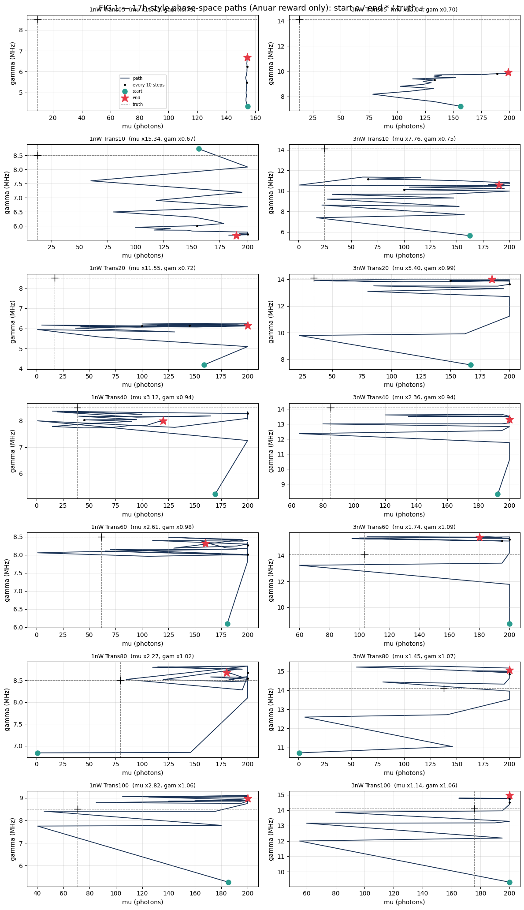

### Experiment own sigma, instead of general

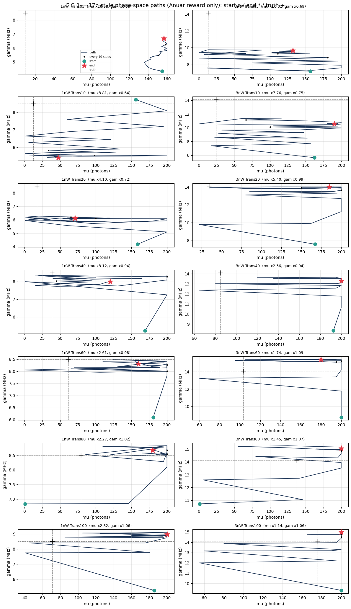

### Remove Clip and restrict LR instead
**Breakthrough**

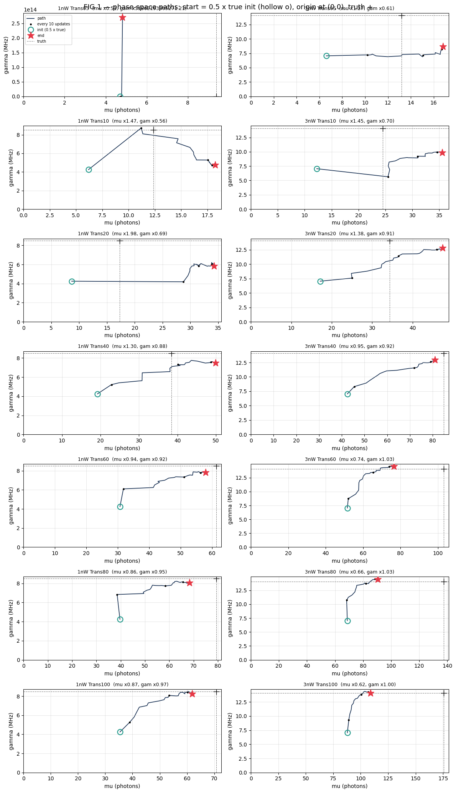

# New AG-HypOpt round (LR and Anneal)

Best result Trial 21 still not perfect, probable not fixable through LR and Anneal

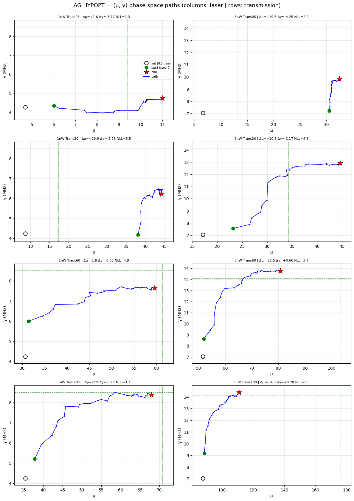

# Distribution Analysis
(Series 22a-d)

# Fisher Uncertainty

We had high uncertainty because Fisher information was averaged not added. With correction we get over confident uncertanties that are very biased.

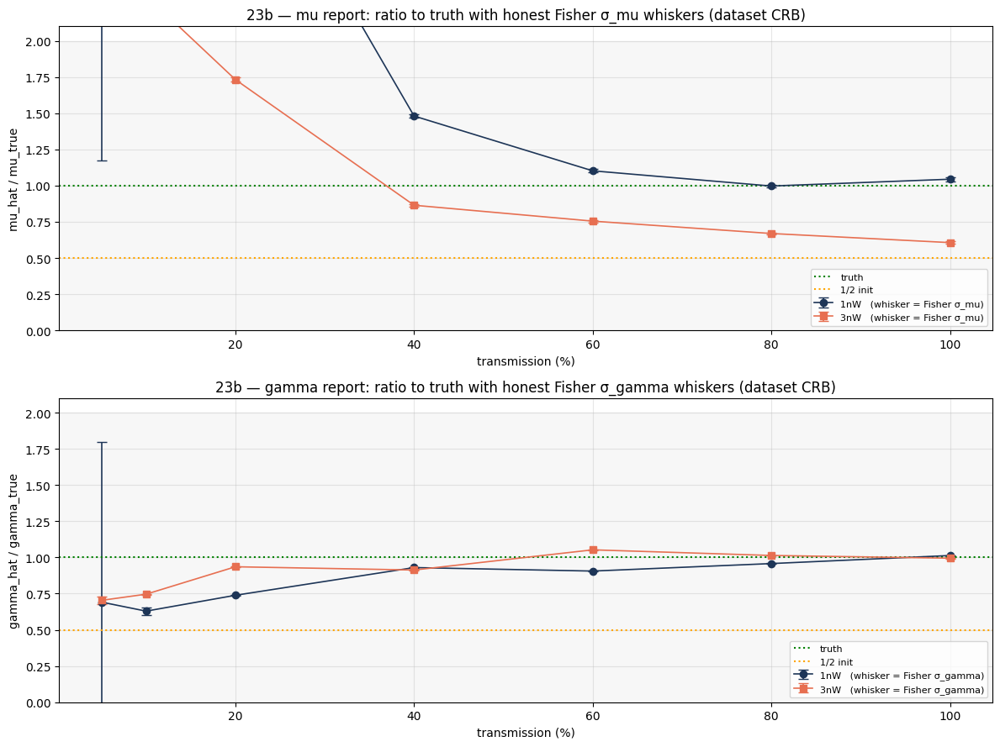

Beim versuchen 3nW zu korrigieren (different learning rate per experiment)

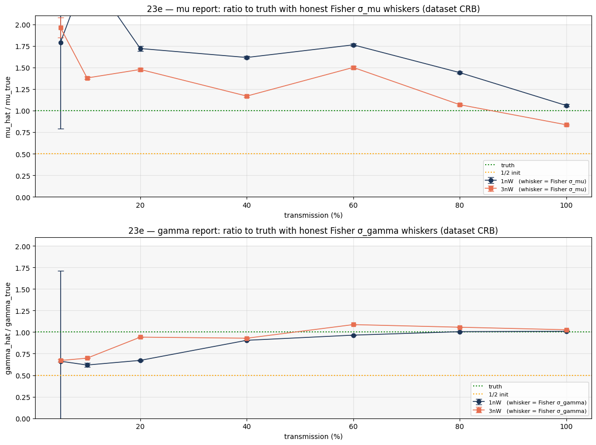

# Next Steps

- Anaylze bandwiths of the kernel (Scott rule, using real or sim data? )
- Sytetic Gaußian idea
- Check if that fixes fisher uncertainty.